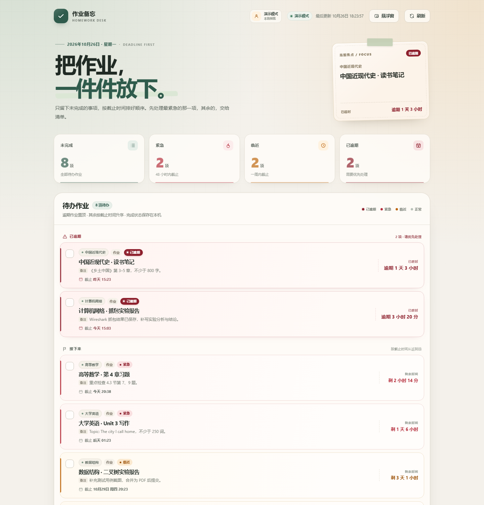
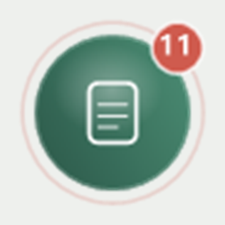
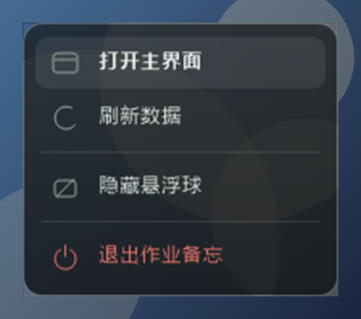
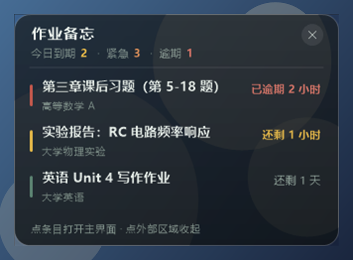

# 作业备忘 · 深大优课桌面版

版本：**1.3.1**（2026-10-28）

一个安装在 Windows 本机的桌面程序，自动登录
[深大优课（TronClass）](https://lms.szu.edu.cn/user/index)、同步未完成作业，并提供
**完整界面**和**桌面悬浮球**两种模式。程序不会打开浏览器，主界面和悬浮球都是应用自己的窗口。

> 非官方个人工具。数据来自 TronClass 的 `/api/todos`；学校系统升级后可能需要相应调整。





> 上图是悬浮球放大 4 倍的效果：中间是作业图标，右上角红底白字是未完成数量；
> 有逾期或 48 小时内到期的作业时，球外会多一圈缓慢呼吸的红环。实际尺寸 80 × 80。

## 目录

- [环境要求](#环境要求) · [安装](#安装) · [使用](#使用)
- 细节：[外观主题](#外观主题) · [悬浮球](#悬浮球) · [窗口过渡动画](#窗口过渡动画) · [右键菜单](#悬浮球右键菜单) · [概览卡片](#悬浮球概览卡片) · [托盘图标](#托盘图标)
- [功能](#功能) · [安全](#安全) · [已知限制](#已知限制) · [文件位置](#文件位置) · [更新与卸载](#更新--卸载)
- [从源码运行](#从源码运行) · [重新打包](#重新打包) · [项目结构](#项目结构) · [版本记录](#版本记录)

## 环境要求

- Windows 10 1809 及以上或 Windows 11，64 位。
- **Microsoft Edge WebView2 运行时**：Windows 11 和较新的 Windows 10 已自带；
  如果启动后主界面一片空白，装一次 Evergreen 运行时即可
  （安装程序不强制捆绑它，避免安装包再大 100 MB）。
- 屏幕分辨率建议 1280 × 720 以上（主窗口最小尺寸 900 × 620）。
- 安装程序只写 `%LOCALAPPDATA%`，**不需要管理员权限**。

## 安装

双击运行：

```
release\作业备忘-安装程序-1.3.1.exe
```

校验值见 `release\SHA256SUMS.txt`（`Get-FileHash <文件> -Algorithm SHA256` 对比）。

安装程序会：

- 安装到 `%LOCALAPPDATA%\Programs\HomeworkDesk`。
- 创建桌面、开始菜单快捷方式。
- 默认创建开机启动项；如果不想开机启动，可在安装时取消勾选「开机自动启动」。
- 不删除已有的登录数据，因此覆盖安装后会继续使用原来的登录状态。

## 使用

1. 双击桌面上的 **作业备忘**。
2. 首次打开会弹窗要求登录深大统一身份认证。学号/密码只在本机处理。
3. 登录后自动显示未完成作业。
4. 点击主窗口右上角的关闭按钮（或 **悬浮球** 按钮）就是把窗口「收起来」：窗口会被
   吸进悬浮球的动画带走，桌面上留下一个 80 × 80 的透明悬浮球，程序继续在后台运行。
5. **单击** 悬浮球原地展开一张毛玻璃概览卡片（今日到期 / 紧急 / 逾期数量 + 最紧急的 3 条作业），玻璃深浅跟着主题走；
   **按住拖动**可以把它挪到任何位置，松手后位置会被记住；**右键** 弹出操作菜单。
6. 任务栏通知区域同样保留「作业备忘」托盘图标，可以从托盘重新打开或退出。

### 外观主题

- 主窗口右上角「主题」按钮（调色板图标）打开主题面板，点一下即时生效、不用重启；
  当前使用中的那套带绿框和「使用中」标签。
- 内置三套：

  | 主题 | 观感 |
  | --- | --- |
  | **暖色**（默认） | 米白纸感底 + 墨绿主色，1.2.x 的老配色 |
  | **亮色** | 中性冷白，白天、玻璃屏下更清爽 |
  | **深色** | 深石板底 + 亮薄荷绿，夜里不刺眼 |

- **悬浮球会跟着换色**：球体渐变、角标、概览卡片玻璃层、文字和右键菜单都按主题重新
  推导，切主题的那一下球就变色了。
- 选择结果存在 `%LOCALAPPDATA%\HomeworkDesk\data\prefs.json` 的 `theme` 字段；
  自定义主题存在同目录的 `themes.json`。

**导入自定义主题**：面板底部「导入主题」→ 粘贴 JSON 或「选择文件」。

```json
{
  "name": "樱",
  "author": "你",
  "description": "四月的粉色主题",
  "scheme": "light",
  "glass": "light",
  "vars": {
    "--bg": "#fdf3f5",
    "--surface": "#fffbfc",
    "--ink": "#2a2026",
    "--green": "#8b3f5a",
    "--green-dark": "#6d2f45"
  }
}
```

- 最少给 3 个变量就能用（一般 `--bg` / `--surface` / `--ink` / 主色就够了），
  其余派生色（hover、描边、强调文字、悬浮球调色板）按 `scheme`（`light` / `dark`）
  自动推导。
- `glass` 决定悬浮球概览卡片是深色玻璃还是浅色玻璃（`dark` / `light`）。
- 想省事就点「复制当前主题 JSON」，拿现成的一套当模板改色号。
- 同名同作者再次导入算「覆盖更新」；自定义主题卡片右上角的垃圾桶点一次会变成
  「删除？」，再点一次才真删。上限 24 个。

> 主题只做 **CSS 变量覆盖**，不接受任意 CSS 片段 —— 这样自定义主题再怎么调也不会把
> 文字和背景撞成一个色，界面始终可读。

### 悬浮球

- 圆形球体，中间是作业图标，右上角是未完成作业的数字角标；有逾期或 48 小时内紧急作业时，
  角标变红并在球外圈出现一圈缓慢呼吸的红环。
- 球体是**原生分层窗口**直接绘制的（不是网页窗口）：80 × 80、`WS_EX_LAYERED` +
  `UpdateLayeredWindow`，圆外像素 alpha 为 0，所以只看到球，没有方形底色。
- 始终置顶，但用 `WS_EX_TOOLWINDOW + WS_EX_NOACTIVATE` 处理：不占任务栏、不进 Alt+Tab、点击时不抢焦点。
- 拖动由窗口自己处理：按下时记下鼠标起点和窗口原点，移动时按「原点 + 位移」重算位置，
  松手把坐标写进 `%LOCALAPPDATA%\HomeworkDesk\data\ball-state.json`；下次显示或重启后回到原处。
- 拖到屏幕边缘会被自动夹回工作区（不会跑到任务栏下面或屏幕外找不回来）。
- 球上的数字每 30 秒 / 主界面数据变化时刷新，与主界面使用同一个本地 API。
- 展开 / 收起动画跑在 **60 fps** 上：Windows 的 `WM_TIMER` 会被 15.625 ms 的系统节拍
  量化（`SetTimer(16)` 实际是 31 ms，只有 32 fps），所以这里改用高精度可等待定时器
  （`CreateWaitableTimerEx` + `CREATE_WAITABLE_TIMER_HIGH_RESOLUTION`）逐帧驱动，
  帧间隔实测 16.0～16.6 ms，没有掉帧。
- 帧时钟是**单线程 + 投递消息**：定时器线程只负责「到点了」，真正的绘制一律回到窗口
  线程做（GDI+ 位图不能跨线程乱改）。万一高精度定时器建不出来会退回 `SetTimer`，
  动画超过「时长 + 0.6 s」还没收尾会被强制复位 —— 时钟出故障最多让动画变糙，
  不会出现「球看得见但点不动」的僵死状态。

### 窗口过渡动画

- **打开**主界面：内容整体淡入并轻轻上浮（280 ms，`cubic-bezier(.22,.68,.32,1)`），
  由页面 CSS 做（合成层，不占 Python 渲染时间）；页面在隐藏状态下收到的请求会挂起，
  等窗口真正可见再播。
- **收起**主界面：窗口被「吸进」悬浮球 —— 先抓住主窗口当前画面，用一个分层窗口按
  `easeInQuad` 缩到球的位置并淡出（280 ms，60 fps），第一帧盖上去之后才隐藏真窗口，
  所以中间不会闪一下桌面；缩到球的尺寸时正好消失，看起来就是窗口被球收走。
- 拖动标题栏也在这个层级实现：按下时记下「光标 − 窗口原点」的偏移，之后由桌面壳按
  60 fps 轮询全局光标、用 `SetWindowPos` 把窗口摆到「光标 − 偏移」（绝对位移，DPI
  缩放下不会漂），一次 IPC 走完整个拖动。

### 悬浮球右键菜单



- 右键球体，球会原地展开成一张菜单（配色同样来自主题），带背景虚化；再次右键 / 按 Esc / 点菜单外面收起。
- 当前项：**打开主界面**、**刷新数据**、**隐藏悬浮球**、**退出作业备忘**（红色）。
- 菜单项由 `DesktopApplication._ball_menu()` 提供，加一项只要往那个列表里塞一个 dict。

### 悬浮球概览卡片



- 左键单击球体：球原地展开成 328 px 宽的毛玻璃卡片，右上角圆形 × 收起。
- 内容：今日到期 / 紧急 / 逾期三个数字，以及最近到期的 3 条作业（标题、课程、剩余时间），
  逾期红色、48 小时内琥珀色。
- 点任意一条作业会打开主界面；点卡片外面、按 Esc 或点 × 收起，窗口变回 80 × 80 的圆球。

### 托盘图标

- 单击托盘图标即可打开主界面；右键弹出菜单。
- 菜单为自绘样式：浅色圆角卡片、悬停时墨绿胶囊高亮，依次是「打开主界面」「显示悬浮球 / 收起悬浮球」「退出作业备忘」，退出项为红色。
- 「显示悬浮球」会按当前状态自动变成「收起悬浮球」；按 Esc 或点菜单外面可关闭菜单。
- 窗口收起时再次双击桌面快捷方式，也会把已经运行的窗口叫回来，不会重复启动。
- 要彻底退出程序，请用托盘菜单里的「退出作业备忘」。

> 1.1.0 里那个 380 × 500 的悬浮窗（`floating.html`）和早期的网页版悬浮球（`ball.html`）
> 都已被原生悬浮球取代，程序不再加载，也不会打进安装包。

## 功能

- 只显示未完成作业，按截止时间升序排列。
- 逾期作业单独置顶，使用最醒目的「已逾期」样式。
- 48 小时内红色「紧急」、7 天内橙色「临近」、7 天以上正常显示。
- 顶部统计：未完成、紧急、临近、逾期。
- 最后更新时间、手动刷新、每 30 秒更新倒计时。
- 登录后自动保存会话；启动时优先复用会话，失效时使用本机加密保存的凭据自动登录。
- 勾选完成后从本应用移除，完成记录持久保存。

## 安全

- 桌面程序内嵌的本地服务只监听 `127.0.0.1` 的随机端口，不对局域网开放。
- 勾选「记住登录」后，学号和密码使用 **Windows DPAPI**（当前 Windows 用户范围）加密，
  保存在 `%LOCALAPPDATA%\HomeworkDesk\data\credentials.dat`。
- 登录 Cookie 同样使用 DPAPI 加密保存在本机。
- 密码只发送给 `authserver.szu.edu.cn`，作业数据只来自 `lms.szu.edu.cn`。
- 不勾选「记住登录」时不会保存密码，只保存本次会话。
- 在登录窗口点击「退出并清除登录信息」可删除本机凭据与会话。

## 已知限制

- 使用非官方接口，学校登录页或 TronClass 升级后可能失效。
- 如果学校登录页强制要求 **滑块验证码**，自动登录会暂停并提示稍后重试。
- 账号若启用短信验证码、FIDO/生物识别或校方二次确认，需要先按学校要求完成验证。
- 勾选完成只会从本应用隐藏，**不会替你在深大优课中提交作业**。
- 完成状态只保存在本机，不与其他设备同步。
- 首次登录前悬浮球取不到数据，角标会显示黄色的 `!`；登录后自动恢复数字。

## 文件位置

| 内容 | 路径 |
| --- | --- |
| 程序 | `%LOCALAPPDATA%\Programs\HomeworkDesk` |
| 登录数据 / 完成记录 | `%LOCALAPPDATA%\HomeworkDesk\data` |
| 日志 | `%LOCALAPPDATA%\HomeworkDesk\data\homework-desk.log` |

日志不含密码。

## 更新 / 卸载

- 更新：关闭应用后重新运行新版安装程序，数据会保留。
- 卸载：Windows「设置 → 应用 → 已安装的应用 → 作业备忘 → 卸载」。
  卸载程序会删除快捷方式和程序文件，但保留 `%LOCALAPPDATA%\HomeworkDesk\data`。
- 如需彻底清除登录数据和完成记录，卸载后手动删除
  `%LOCALAPPDATA%\HomeworkDesk\data`。

## 从源码运行

桌面壳是 Python + pywebview（WebView2），界面仍然是单文件 HTML/CSS/JS，没有前端构建步骤。

```powershell
# 需要 Python 3.11+（开发机用的是 3.14）
py -3.14 -m venv .venv
.\.venv\Scripts\Activate.ps1
pip install -r requirements.txt

python desktop_app.py
```

不装 exe 直接跑源码时，数据和日志同样落在 `%LOCALAPPDATA%\HomeworkDesk\data`，
和安装版共用一套登录状态。程序有单实例保护，默认后启动的会把已有的叫回来；
给源码实例加一个 `HOMEWORK_DESK_MUTEX_SUFFIX=dev` 就能与安装版同时运行（数据仍共用，
建议测试时配合 `HOMEWORK_DESK_DATA_DIR` 换个目录）。

调试开关（PowerShell：`$env:HOMEWORK_DESK_DEBUG=1; python desktop_app.py`）：

| 环境变量 | 作用 |
| --- | --- |
| `HOMEWORK_DESK_DEBUG=1` | 日志降到 DEBUG 级别，并打开 WebView2 开发者工具 |
| `HOMEWORK_DESK_AUTOSHOW_FLOAT=1` | 启动后自动走一遍「关闭主窗口 → 吸进悬浮球」，用来回归收缩动画与球的交互 |
| `HOMEWORK_DESK_PORT=8765` | 指定内嵌服务端口 |
| `HOMEWORK_DESK_DATA_DIR=<路径>` | 换数据目录，测试时避免污染正式数据 |
| `HOMEWORK_DESK_MUTEX_SUFFIX=<后缀>` | 给单实例互斥体加后缀，让源码实例与安装版并存 |
| `HOMEWORK_DESK_REMOTE_DEBUG=<端口>` | 打开 WebView2 远程调试端口 |

## 重新打包

```powershell
# 1. 依赖装进同一个虚拟环境（PyInstaller 也在 requirements.txt 里）
py -3.14 -m venv .venv
.\.venv\Scripts\Activate.ps1
pip install -r requirements.txt

# 2. 构建 EXE，产物在 dist\HomeworkDesk
pyinstaller --noconfirm --clean HomeworkDesk.spec

# 3. 构建安装程序（需 Inno Setup 6，产物输出到仓库外的 ..\version）
& "${env:ProgramFiles(x86)}\Inno Setup 6\ISCC.exe" .\installer.iss
```

`build.ps1` 会一次跑完第 2、3 步（它假设 `py -3.14` 自己已经装好 PyInstaller）。

两个踩过的坑：

- **`py -3.14 -m PyInstaller` 报 `No module named PyInstaller`**：说明系统 Python 里没装，
  或者依赖装在了别的虚拟环境 —— 一定要用装好依赖的那个解释器来构建。
- **`dist\` 被正在运行的程序占用**：PyInstaller 会因无法覆盖而失败。先把旧目录挪走
  （`mv dist\HomeworkDesk dist\_old\...`），或者用 `--distpath dist_build` 换个输出目录。

## 项目结构

| 文件 | 作用 |
| --- | --- |
| `desktop_app.py` | 桌面壳：无边框主窗口、悬浮球生命周期与位置记忆、拖动 / 缩放、托盘、单实例 |
| `ball_window.py` | 悬浮球 + 右键菜单 + 概览卡片：原生分层窗口 + GDI+ 自绘，圆外逐像素透明 |
| `themes.py` | 外观主题：内置三套主题、自定义主题校验与派生色、悬浮球调色板推导 |
| `shrink_anim.py` | 「窗口被吸进悬浮球」的收起动画：抓帧后按 `easeInQuad` 缩放淡出 |
| `homework_server.py` | 内嵌本地服务（`127.0.0.1` 随机端口）、DPAPI 加密、深大登录与 TronClass 同步 |
| `homework-reminder.html` | 主界面（单文件 HTML/CSS/JS） |
| `HomeworkDesk.spec` | PyInstaller 打包配置 |
| `installer.iss` | Inno Setup 安装脚本（产物写到 `..\version`） |
| `build.ps1` | 一键构建 EXE + 安装程序 |
| `requirements.txt` | 运行与打包依赖 |
| `release/` | 交付目录：安装包与 `SHA256SUMS.txt`（**有意提交进版本库**） |
| `preview*.png` | README 用的截图（主界面、悬浮球、右键菜单、概览卡片） |
| `HANDOVER.md` | 交接文档：架构细节、排错表、验证清单 |
| `CHANGELOG.md` | 版本变更记录 |
| `ball.html` / `floating.html` | 旧版悬浮球与 1.1.0 的 380 × 500 悬浮窗，已不再被引用（历史文件） |

安全说明、构建流程和排错表也见 [HANDOVER.md](HANDOVER.md)。

## 版本记录

| 版本 | 日期 | 要点 |
| --- | --- | --- |
| **1.3.1** | 10-28 | 新增外观主题（暖色 / 亮色 / 深色）与自定义主题导入，悬浮球跟着换色；修复未登录时概览卡片中间空白 |
| 1.2.3 | 10-28 | 修复 1.2.2 引入的「悬浮球左右键失灵」（跨模块覆盖了 Win32 定时器原型，逐帧时钟线程崩溃）；动画加了降级与超时自愈 |
| 1.2.2 | 10-28 | 标题栏改为原生拖动；关闭窗口变成「吸进悬浮球」的收起动画（`shrink_anim.py`） |
| 1.2.1 | 10-28 | 悬浮球右键菜单与概览卡片；60 fps 高精度帧时钟；主窗口淡入淡出 |
| 1.2.0 | 10-28 | 悬浮球换成原生分层窗口（替代 WebView2 悬浮窗），无边框主窗口、自绘托盘菜单 |
| 1.1.0 | 10-26 | 首个桌面壳（pywebview），380 × 500 置顶悬浮窗 |

完整变更记录见 [CHANGELOG.md](CHANGELOG.md)。
