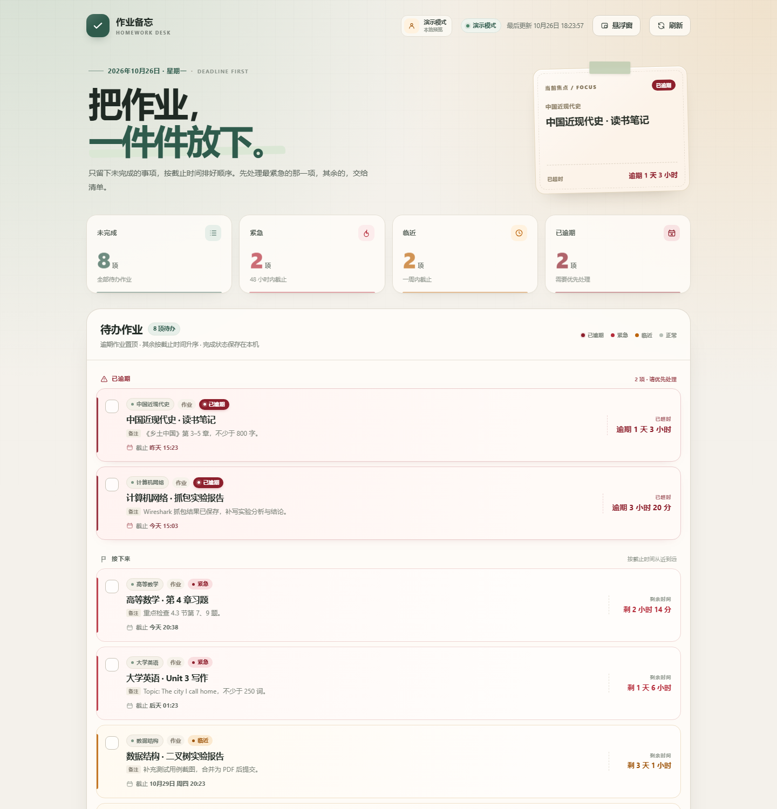
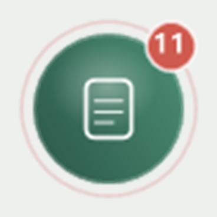
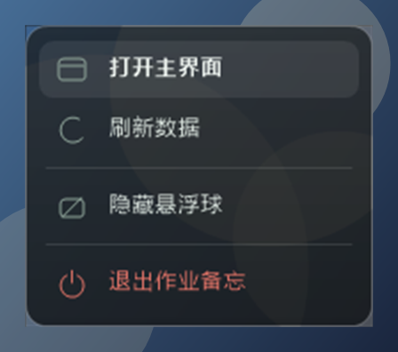
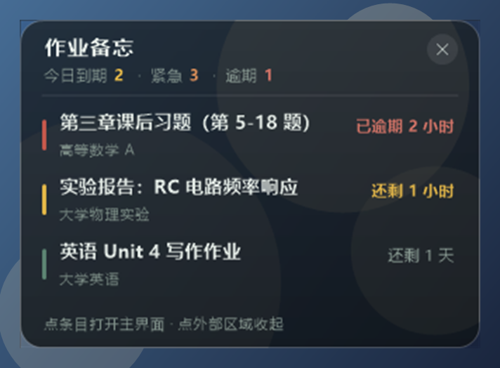

# 作业备忘 · 深大作业聚合桌面版

版本：**2.0.0**（2026-11-08）

一个安装在 Windows 本机的桌面程序，把
[深大优课（TronClass）](https://lms.szu.edu.cn/user/index) 的**课程作业**和校内 **OJ 判题系统**
的**实验**聚到同一个待办列表，并提供**完整界面**和**桌面悬浮球**两种模式。程序不会打开浏览器，
主界面和悬浮球都是应用自己的窗口。

从 2.0.0 起，这个程序不再只盯畅课一件事：实验和作业混排，逾期置顶、其余按截止时间排序，
已交的实验直接显示判题得分，不用再在两个网站之间来回切。两个平台各自登录：都登录时看板
左右分栏，只登录一个时另一个留一个登录入口，不会互相挡住。
（版本号从 1.5.3 直接跳到 2.0.0：作业源从一个变成两个，属于结构性变更，不另发 1.6。）

在畅课那一侧，还能查看作业正文、把附件**原样下载到桌面**、在卡片里直接**交作业**
（多个文件可打包成一个 ZIP），都不用跳浏览器；OJ 那一侧是只读的，只拉清单和得分。

> 非官方个人工具。数据来自 TronClass 的 `/api/todos` 和 OJ 的 `/api/contests`；
> 学校系统升级后可能需要相应调整。





> 上图是悬浮球放大 4 倍的效果：中间是作业图标，右上角红底白字是未完成数量；
> 有逾期或 48 小时内到期的作业时，球外会多一圈缓慢呼吸的红环。实际尺寸 80 × 80。

## 目录

- [环境要求](#环境要求) · [安装](#安装) · [使用](#使用) · [两个来源怎么排](#两个来源怎么排) · [提交作业](#提交作业) · [已完成 / 恢复](#已完成--恢复) · [OJ 实验与得分](#oj-实验与得分)
- 细节：[外观主题](#外观主题) · [悬浮球](#悬浮球) · [窗口过渡动画](#窗口过渡动画) · [右键菜单](#悬浮球右键菜单) · [概览卡片](#悬浮球概览卡片) · [托盘图标](#托盘图标)
- [功能](#功能) · [安全](#安全) · [已知限制](#已知限制) · [文件位置](#文件位置) · [更新与卸载](#更新--卸载)
- [从源码运行](#从源码运行) · [重新打包](#重新打包) · [项目结构](#项目结构) · [版本记录](#版本记录)

## 环境要求

- **64 位** Windows 10 1809 及以上或 Windows 11。32 位系统安装程序会直接拒绝；
  Win7 / 8 / 8.1 会在安装第一步提示版本过低（界面靠 WebView2 渲染，Edge 从 109 版起已不支持它们）。
- **Microsoft Edge WebView2 运行时**：Windows 11 和较新的 Windows 10 已自带。
  缺失时启动会弹窗说明，点「是」直接打开微软官方下载页——不会出现「双击没反应」。
  （安装包不捆绑它，否则安装包得多 100 MB。）
- .NET Framework 4.7.2 以上（Windows 10 1809 起系统自带 4.8，一般无感）。
- 屏幕分辨率建议 1280 × 720 以上（主窗口最小尺寸 900 × 620）。
- 安装程序只写 `%LOCALAPPDATA%`，**不需要管理员权限**。

## 安装

双击运行：

```
release\作业备忘-安装程序-2.0.0.exe
```

校验值见 `release\SHA256SUMS.txt`（每行是「哈希 `*文件名`」）。在仓库根目录核对当前版本：

```powershell
(Get-FileHash 'release\作业备忘-安装程序-2.0.0.exe' -Algorithm SHA256).Hash.ToLower()
# 输出要和 SHA256SUMS.txt 里 2.0.0 那一行完全一致
```

> `release\` 里保留 1.2.3 起每个版本的安装包，需要回滚时直接装旧包；所有版本的校验值
> 都记在同一个 `SHA256SUMS.txt` 里。

安装程序会：

- 安装到 `%LOCALAPPDATA%\Programs\HomeworkDesk`。
- 创建桌面、开始菜单快捷方式。
- 默认创建开机启动项；如果不想开机启动，可在安装时取消勾选「开机自动启动」。
- 不删除已有的登录数据，因此覆盖安装后会继续使用原来的登录状态。

## 使用

1. 双击桌面上的 **作业备忘**。
2. 首次打开会弹窗要求登录深大统一身份认证。学号/密码只在本机处理。
3. 登录后自动显示畅课未完成的作业；想同时看 OJ 的实验，点顶栏的 `OJ` 按钮登一次
   （验证码直接显示在窗口里，一次约管两周）。
4. 点击主窗口右上角的关闭按钮（或 **悬浮球** 按钮）就是把窗口「收起来」：窗口会被
   吸进悬浮球的动画带走，桌面上留下一个 80 × 80 的透明悬浮球，程序继续在后台运行。
5. **单击** 悬浮球原地展开一张毛玻璃概览卡片（今日到期 / 紧急 / 逾期数量 + 最紧急的 3 条作业），玻璃深浅跟着主题走；
   **按住拖动**可以把它挪到任何位置，松手后位置会被记住；**右键** 弹出操作菜单。
6. 任务栏通知区域同样保留「作业备忘」托盘图标，可以从托盘重新打开或退出。

### 两个来源怎么排

**2.0.0 新增。** 畅课作业和 OJ 实验分属两个系统，登录状态也可能不一样，看板按「有几个源
在用」自动换布局，不用手动切：

| 状态 | 布局 |
| --- | --- |
| 两个都登录 | **左右两栏**：左边深大优课、右边 OJ 判题（约 1.08 : 0.92），顶部总计数仍是两边合并 |
| 只登录其中一个 | **单栏整幅**：已登录的那块铺满宽度，没登录的那块在它下面留一句提示和登录按钮 |
| 都没登录 | 一张登录卡（和 1.5.x 一样），并弹出畅课登录框 |

- 窗口窄于 **1080 px** 时，左右两栏自动退回上下排列，不会把卡片挤成一列字。
- 只登录 OJ 时**不会**弹畅课的登录框挡住列表 —— 畅课那块给一个「登录深大优课」按钮，
  想登再登；反过来只登录畅课时，OJ 那块给「登录 OJ」按钮。
- 半栏宽度下，卡片会把「剩余时间 / 得分」从右侧竖栏挪到标题下方右对齐，标题因此不被挤断。

### 外观主题

- 主窗口右上角「主题」按钮（调色板图标）打开主题面板，点一下即时生效、不用重启；
  当前使用中的那套带绿框和「使用中」标签。
- 内置三套：

  | 主题 | 观感 |
  | --- | --- |
  | **暖色**（默认） | 米白纸感底 + 墨绿主色，1.2.x 的老配色 |
  | **亮色** | 中性冷白，白天、玻璃屏下更清爽 |
  | **深色** | 深石板底 + 亮薄荷绿，夜里不刺眼 |

- **悬浮球会跟着换色**：球体渐变、角标、概览卡片玻璃层、文字和右键菜单都按主题重新
  推导，切主题的那一下球就变色了。
- 选择结果存在 `%LOCALAPPDATA%\HomeworkDesk\data\prefs.json` 的 `theme` 字段；
  自定义主题存在同目录的 `themes.json`。

**导入自定义主题**：面板底部「导入主题」→ 粘贴 JSON 或「选择文件」。

```json
{
  "name": "樱",
  "author": "你",
  "description": "四月的粉色主题",
  "scheme": "light",
  "glass": "light",
  "vars": {
    "--bg": "#fdf3f5",
    "--surface": "#fffbfc",
    "--ink": "#2a2026",
    "--green": "#8b3f5a",
    "--green-dark": "#6d2f45"
  }
}
```

- 最少给 3 个变量就能用（一般 `--bg` / `--surface` / `--ink` / 主色就够了），
  其余派生色（hover、描边、强调文字、悬浮球调色板）按 `scheme`（`light` / `dark`）
  自动推导。
- `glass` 决定悬浮球概览卡片是深色玻璃还是浅色玻璃（`dark` / `light`）。
- 想省事就点「复制当前主题 JSON」，拿现成的一套当模板改色号。
- 同名同作者再次导入算「覆盖更新」；自定义主题卡片右上角的垃圾桶点一次会变成
  「删除？」，再点一次才真删。上限 24 个。

> 主题只做 **CSS 变量覆盖**，不接受任意 CSS 片段 —— 这样自定义主题再怎么调也不会把
> 文字和背景撞成一个色，界面始终可读。

### 悬浮球

- 圆形球体，中间是作业图标，右上角是未完成作业的数字角标；有逾期或 48 小时内紧急作业时，
  角标变红并在球外圈出现一圈缓慢呼吸的红环。**已经在 OJ 交掉的实验不计入角标** ——
  它们只是留在列表里 7 天供回看得分，不算还欠着的活。
- 球体是**原生分层窗口**直接绘制的（不是网页窗口）：80 × 80、`WS_EX_LAYERED` +
  `UpdateLayeredWindow`，圆外像素 alpha 为 0，所以只看到球，没有方形底色。
- 始终置顶，但用 `WS_EX_TOOLWINDOW + WS_EX_NOACTIVATE` 处理：不占任务栏、不进 Alt+Tab、点击时不抢焦点。
- 拖动由窗口自己处理：按下时记下鼠标起点和窗口原点，移动时按「原点 + 位移」重算位置，
  松手把坐标写进 `%LOCALAPPDATA%\HomeworkDesk\data\ball-state.json`；下次显示或重启后回到原处。
- 拖到屏幕边缘会被自动夹回工作区（不会跑到任务栏下面或屏幕外找不回来）。
- 球上的数字每 30 秒 / 主界面数据变化时刷新，与主界面使用同一个本地 API。
- 展开 / 收起动画跑在 **60 fps** 上：Windows 的 `WM_TIMER` 会被 15.625 ms 的系统节拍
  量化（`SetTimer(16)` 实际是 31 ms，只有 32 fps），所以这里改用高精度可等待定时器
  （`CreateWaitableTimerEx` + `CREATE_WAITABLE_TIMER_HIGH_RESOLUTION`）逐帧驱动，
  帧间隔实测 16.0～16.6 ms，没有掉帧。
- 帧时钟是**单线程 + 投递消息**：定时器线程只负责「到点了」，真正的绘制一律回到窗口
  线程做（GDI+ 位图不能跨线程乱改）。万一高精度定时器建不出来会退回 `SetTimer`，
  动画超过「时长 + 0.6 s」还没收尾会被强制复位 —— 时钟出故障最多让动画变糙，
  不会出现「球看得见但点不动」的僵死状态。

### 窗口过渡动画

- **打开**主界面：内容整体淡入并轻轻上浮（280 ms，`cubic-bezier(.22,.68,.32,1)`），
  由页面 CSS 做（合成层，不占 Python 渲染时间）；页面在隐藏状态下收到的请求会挂起，
  等窗口真正可见再播。
- **收起**主界面：窗口被「吸进」悬浮球 —— 先抓住主窗口当前画面，用一个分层窗口按
  `easeInQuad` 缩到球的位置并淡出（280 ms，60 fps），第一帧盖上去之后才隐藏真窗口，
  所以中间不会闪一下桌面；缩到球的尺寸时正好消失，看起来就是窗口被球收走。
- 拖动标题栏也在这个层级实现：按下时记下「光标 − 窗口原点」的偏移，之后由桌面壳按
  60 fps 轮询全局光标、用 `SetWindowPos` 把窗口摆到「光标 − 偏移」（绝对位移，DPI
  缩放下不会漂），一次 IPC 走完整个拖动。

### 悬浮球右键菜单



- 右键球体，球会原地展开成一张菜单（配色同样来自主题），带背景虚化；再次右键 / 按 Esc / 点菜单外面收起。
- 当前项：**打开主界面**、**刷新数据**、**隐藏悬浮球**、**退出作业备忘**（红色）。
- 菜单项由 `DesktopApplication._ball_menu()` 提供，加一项只要往那个列表里塞一个 dict。

### 悬浮球概览卡片



- 左键单击球体：球原地展开成 328 px 宽的毛玻璃卡片，右上角圆形 × 收起。
- 内容：今日到期 / 紧急 / 逾期三个数字，以及最近到期的 3 条作业（标题、课程、剩余时间），
  逾期红色、48 小时内琥珀色。
- 点任意一条作业会打开主界面；点卡片外面、按 Esc 或点 × 收起，窗口变回 80 × 80 的圆球。

### 托盘图标

- 单击托盘图标即可打开主界面；右键弹出菜单。
- 菜单为自绘样式：浅色圆角卡片、悬停时墨绿胶囊高亮，依次是「打开主界面」「显示悬浮球 / 收起悬浮球」「退出作业备忘」，退出项为红色。
- 「显示悬浮球」会按当前状态自动变成「收起悬浮球」；按 Esc 或点菜单外面可关闭菜单。
- 窗口收起时再次双击桌面快捷方式，也会把已经运行的窗口叫回来，不会重复启动。
- 要彻底退出程序，请用托盘菜单里的「退出作业备忘」。

> 1.1.0 里那个 380 × 500 的悬浮窗（`floating.html`）和早期的网页版悬浮球（`ball.html`）
> 都已被原生悬浮球取代，程序不再加载，也不会打进安装包。

### 提交作业

**1.5.1 新增。** 作业内容展开后，附件下面多一块「提交作业」，整个流程都在卡片里完成，
不用跳浏览器；功能与网页端一致：选文件、写说明、存草稿、提交、撤回。

- **打包成 ZIP**：勾上之后，选中的文件会先打成一个压缩包再传，压缩包名可以自己填
  （默认用作业标题，非法字符自动去掉、太长自动截断、自动补 `.zip`）。两种情况下用得到：
  - 平台不接受某些后缀（比如把 `.exe`、`.py` 直接传会被拦），打包后是一个 `.zip` 就能过；
  - 一次要交一整个工程目录，几十个文件一个个传既慢又乱。
  压缩包里会多一个 `提交说明.txt`，记着作业标题和你在备注里写的话。
- **选文件 / 选文件夹**：可以一次选多个文件，也可以整目录选（会保留文件夹层级，
  打包时在压缩包里也是同样的目录结构）。
- **说明**：选填，老师那边会看到。只有文字说明、不带文件也可以交。
- **存草稿**：只存在平台上，老师看不到；之后再点「提交作业」会把这份草稿改成正式提交。
- **二次确认**：点「提交作业」先弹确认框，写清楚交去哪门课的哪条作业、交的是什么文件、
  是不是打包、是不是又一次提交；点「确定提交」才真的发出去。
- **撤回**：交完之后卡片上会显示「已提交 · 时间」和一个「撤回」按钮（老师关掉撤回权限时不显示）。
- 已提交的作业仍然可以再交一份，新的一份会变成最新版本，旧的留作历史。

> 提交是不可逆的外部动作：交上去老师立刻能看到，本机没有办法"当作没交过"，只能撤回，
> 而撤回会留下记录。所以这里一定会有确认框，不会静默上传。

### 已完成 / 恢复

**1.5.2 新增，1.5.3 补了提交记录。** 待办列表标题右边那个虚线小按钮「已完成 N」就是这里 ——
本机勾成完成的作业都收在里面，误点了随时能捞回来。

- 列表按完成时间倒序，显示标题、课程和「完成于 2026-10-29 16:44」这样的时间。
- **提交记录**：每条右侧的「提交记录」会向平台查这条作业交过什么 —— 已提交 / 草稿、
  提交时间、说明、附件清单（文件名 + 大小）；查不到会明说，不装成「没交」。
  结果按作业缓存，展开收起不会重复请求。
- 顶上搜索框按标题/课程过滤，纯本地匹配，不联网。
- 单条点「恢复」：删掉本机记录，并立即重新拉一次待办，作业回到列表原来该在的位置。
- 「全部恢复」会按**当前筛选结果**批量撤销，动手前有一次确认。
- 多个窗口（主窗口、悬浮球弹出的概览）靠广播同步；万一没跟上，点「重新读取」直接从
  `state.json` 再读一遍。

> 恢复只改本机记录，LMS 上不会有任何变化。如果那条作业平台已经不再列进待办
> （截止很久了、老师收回了），主界面不会重新出现它，但记录确实删掉了。

### OJ 实验与得分

**2.0.0 新增。** OJ 是学校自己搭的判题系统（`http://172.31.221.62`，QDUOJ 内核），
实验和课后作业都发在上面。这个版本把它接成第二个作业源。

**怎么连**

顶栏账号按钮右边有一个 `OJ` 状态按钮，点开是登录框：

| 圆点颜色 | 含义 |
| --- | --- |
| 灰 | 还没配过 OJ |
| 绿 | 已连接，正在同步 |
| 橙 | 当前离线（不在校内网 / VPN 断了），列表里保留上次同步到的内容 |
| 红 | 会话失效，需要重新登录 |

第一次登录要输学号、密码和**图形验证码**（验证码直接显示在窗口里，点图片可换一张）。
登录成功后只把 `sessionid` 加密存本机，之后自动复用 —— 服务端的会话大约两周过期，
到期后重新输一次验证码即可，不用每次打开都输。

**列表里长什么样**

OJ 的条目和畅课作业混在同一个列表里，靠卡片左上角的绿色 `OJ` 徽标区分，排序规则完全一样。

- **还没交**：跟普通待办一样，显示剩余时间和题量（`5 道题 · 满分 100`）。
- **交了**：单独落在底部「已在 OJ 提交」分组，卡片变淡绿、勾选框置灰，右侧直接显示
  `90 / 100`；备注行说明判题是否完成。**保留 7 天**，方便回看分数，之后自动消失。
- **过期没交**：留在「已逾期」分组里提醒，勾掉「已完成」才消失，和畅课的逾期作业一个逻辑。

每张 OJ 卡片底部有「在 OJ 打开 ↗」，点一下用默认浏览器打开那场实验。

**几条边界**

- **只读**。这个版本只从 OJ 拉清单和得分，不会替你提交代码、撤销提交或改分数。
- **和畅课各自登录，互不牵连**。只登 OJ、没登畅课也能正常用：看板会把 OJ 那块显示出来，
  畅课那块留一句「还没登录深大优课」和一个登录按钮，不弹框、不挡列表。
- OJ 没有 token 也没有「记住我」，只能靠 cookie 会话；会话存在
  `%LOCALAPPDATA%\HomeworkDesk\data\oj_session.dat`，用 DPAPI 加密。
- 不在校内网时不会弹错误框挡住畅课，只是这次不显示 OJ 那几条，状态点变橙色。
- **列表不会自己变**：主界面只在启动和点右上角「刷新」时重绘；悬浮球的角标每 30 秒会
  自己更新，但主界面不会跟着变。想看到新发布的实验，手动刷一次即可。
- 已经结束 **30 天**还没交的实验会从列表里移除，避免陈年旧账一直挂在「已逾期」；
  已交的按上面说的保留 7 天。
- OJ 的地址写死在校内网 IP 上（`http://172.31.221.62`），登录框里的「服务地址」只是显示、
  不能改。**每学期可能会变**，真变了要改 `oj_client.py` 的 `DEFAULT_BASE` 一行后重新打包。

## 功能

- 只显示未完成的作业和实验（畅课 + OJ 两个来源），按截止时间升序排列。
- 逾期作业单独置顶，使用最醒目的「已逾期」样式。
- 48 小时内红色「紧急」、7 天内橙色「临近」、7 天以上正常显示。
- 顶部统计：未完成、紧急、临近、逾期。
- 最后更新时间、手动刷新、每 30 秒更新倒计时。
- 登录后自动保存会话；启动时优先复用会话，失效时使用本机加密保存的凭据自动登录。
- 勾选完成前会弹一次确认（列出作业、课程、截止时间），误触不会直接消失；
  勾完从本应用移除，完成记录持久保存，列表右上角「已完成 N」可查这批记录，
  支持搜索、**恢复**和**查提交记录**（不用重启程序）。
- 卡片上「查看作业内容」直接展开老师写的正文（段落、列表、表格、图片都保留），不用跳浏览器。
- 展开后列出该作业的全部附件，点一下就能**下载到桌面**；多个附件可一键「全部下载」，
  **原样下载**（docx 还是 docx、pptx 还是 pptx，文件名和大小都不变），
  重名自动加序号，不会覆盖桌面上已有的文件。
- 交作业：展开后的「提交作业」里选文件（或整个文件夹）、写说明、存草稿、提交、撤回；
  文件多或者后缀被平台拦时，可以勾选**打包成 ZIP** 再传，压缩包名可自定义。
- **OJ 实验同屏**：校内 OJ 上的实验并入同一看板，绿 `OJ` 徽标区分来源；已交的单独成组，
  显示判题得分并保留 7 天，过期没交的进「已逾期」提醒；每张卡片可一键在浏览器打开原实验。
- **两个来源分栏**：两边都登录时左右并排（畅课在左、OJ 在右），只登录一个时那一块铺满整幅，
  另一边留一行提示和登录按钮；窗口窄于 1080 px 自动变成上下排列。

## 安全

- 桌面程序内嵌的本地服务只监听 `127.0.0.1` 的随机端口，不对局域网开放。
- 勾选「记住登录」后，学号和密码使用 **Windows DPAPI**（当前 Windows 用户范围）加密，
  保存在 `%LOCALAPPDATA%\HomeworkDesk\data\credentials.dat`。
- 登录 Cookie 同样使用 DPAPI 加密保存在本机。
- OJ 的 `sessionid` 也走 DPAPI，单独存在 `oj_session.dat`；两套登录互不影响。
- 密码只发送给 `authserver.szu.edu.cn`，作业数据只来自 `lms.szu.edu.cn`，
  实验清单只来自校内 OJ 的 `172.31.221.62`。
- 交作业时文件由本机服务直传给优课，**不上传任何第三方**；本机不保留副本，压缩包在内存里生成、传完即弃。
- 不勾选「记住登录」时不会保存密码，只保存本次会话。
- 在登录窗口点击「退出并清除登录信息」可删除本机凭据与会话。

## 已知限制

- 使用非官方接口，学校登录页、TronClass 或 OJ 升级后可能失效。
- 如果学校登录页强制要求 **滑块验证码**，自动登录会暂停并提示稍后重试。
- 账号若启用短信验证码、FIDO/生物识别或校方二次确认，需要先按学校要求完成验证。
- 勾选完成只会从本应用隐藏，**不等于交作业**；要交作业得用展开区里的「提交作业」。
  勾错了到列表右上角「已完成 N」里点「恢复」即可。
- 提交走的是网页端同一套接口：只支持「文件上传」型作业（现在所有作业都是这种），在线答题型不做；平台把附件存在七牛云上的情况下不支持上传，会提示到网页交。
- 上传大小上限单次 300 MB / 40 个文件；交大文件建议勾选打包成 ZIP，压缩后体积通常小很多。
- 完成状态只保存在本机，不与其他设备同步。
- **OJ 只在校内网可访问**。不在校园网又没有 VPN 时，OJ 那几条显示不出来，但不影响畅课；
  状态点会变橙色，鼠标悬停能看到最后同步时间。
- **OJ 是只读的**：能看实验清单和得分，不能在应用里提交代码；要交题还是点「在 OJ 打开」。
- OJ 的 cookie 会话约两周过期，到期后需要重新输一次验证码；这一步没法全自动（验证码在服务端校验）。
- **只登录其中一个系统时**，另一个的作业不会出现（本来也没登录）；空着的那一块会留一个
  登录入口，不会用登录卡把整页盖住。
- 左右两栏需要窗口宽度 ≥ **1080 px**，再窄会自动改成上下排列（窗口最小 900 px）。
- 已交的 OJ 实验只保留 7 天，之后连得分也不再显示。
- 「已完成」里的提交记录是现查平台接口，需要联网且登录有效；作业被老师关闭或删除后
  可能查不到，这时会明确显示「没有查到提交记录」，不会猜测。
- 首次登录前悬浮球取不到数据，角标会显示黄色的 `!`；登录后自动恢复数字。

## 文件位置

| 内容 | 路径 |
| --- | --- |
| 程序 | `%LOCALAPPDATA%\Programs\HomeworkDesk` |
| 登录数据 / 完成记录 | `%LOCALAPPDATA%\HomeworkDesk\data` |
| OJ 会话 | `%LOCALAPPDATA%\HomeworkDesk\data\oj_session.dat`（DPAPI 加密） |
| 日志 | `%LOCALAPPDATA%\HomeworkDesk\data\homework-desk.log` |

日志不含密码。

## 更新 / 卸载

- 更新：关闭应用后重新运行新版安装程序，数据会保留。
- 卸载：Windows「设置 → 应用 → 已安装的应用 → 作业备忘 → 卸载」。
  卸载程序会删除快捷方式和程序文件，但保留 `%LOCALAPPDATA%\HomeworkDesk\data`。
- 如需彻底清除登录数据和完成记录，卸载后手动删除
  `%LOCALAPPDATA%\HomeworkDesk\data`。

## 从源码运行

桌面壳是 Python + pywebview（WebView2），界面仍然是单文件 HTML/CSS/JS，没有前端构建步骤。

```powershell
# 需要 Python 3.11+（开发机用的是 3.14）
py -3.14 -m venv .venv
.\.venv\Scripts\Activate.ps1
pip install -r requirements.txt

python desktop_app.py
```

不装 exe 直接跑源码时，数据和日志同样落在 `%LOCALAPPDATA%\HomeworkDesk\data`，
和安装版共用一套登录状态。程序有单实例保护，默认后启动的会把已有的叫回来；
给源码实例加一个 `HOMEWORK_DESK_MUTEX_SUFFIX=dev` 就能与安装版同时运行（数据仍共用，
建议测试时配合 `HOMEWORK_DESK_DATA_DIR` 换个目录）。

调试开关（PowerShell：`$env:HOMEWORK_DESK_DEBUG=1; python desktop_app.py`）：

| 环境变量 | 作用 |
| --- | --- |
| `HOMEWORK_DESK_DEBUG=1` | 日志降到 DEBUG 级别，并打开 WebView2 开发者工具 |
| `HOMEWORK_DESK_AUTOSHOW_FLOAT=1` | 启动后自动走一遍「关闭主窗口 → 吸进悬浮球」，用来回归收缩动画与球的交互 |
| `HOMEWORK_DESK_PORT=8765` | 指定内嵌服务端口 |
| `HOMEWORK_DESK_DATA_DIR=<路径>` | 换数据目录，测试时避免污染正式数据 |
| `HOMEWORK_DESK_MUTEX_SUFFIX=<后缀>` | 给单实例互斥体加后缀，让源码实例与安装版并存 |
| `HOMEWORK_DESK_REMOTE_DEBUG=<端口>` | 打开 WebView2 远程调试端口 |

## 重新打包

```powershell
# 1. 依赖装进同一个虚拟环境（PyInstaller 也在 requirements.txt 里）
py -3.14 -m venv .venv
.\.venv\Scripts\Activate.ps1
pip install -r requirements.txt

# 2. 构建 EXE，产物在 dist\HomeworkDesk
pyinstaller --noconfirm --clean HomeworkDesk.spec

# 3. 构建安装程序（需 Inno Setup 6，产物输出到仓库外的 ..\version）
& "${env:ProgramFiles(x86)}\Inno Setup 6\ISCC.exe" .\installer.iss
```

`build.ps1` 会一次跑完全部步骤（它假设 `py -3.14` 自己已经装好 PyInstaller）。

两个踩过的坑：

- **`py -3.14 -m PyInstaller` 报 `No module named PyInstaller`**：说明系统 Python 里没装，
  或者依赖装在了别的虚拟环境 —— 一定要用装好依赖的那个解释器来构建。
- **`dist\` 被正在运行的程序占用**：PyInstaller 会因无法覆盖而失败。先把旧目录挪走
  （`mv dist\HomeworkDesk dist\_old\...`），或者用 `--distpath dist_build` 换个输出目录。

## 项目结构

| 文件 | 作用 |
| --- | --- |
| `desktop_app.py` | 桌面壳：无边框主窗口、悬浮球生命周期与位置记忆、拖动 / 缩放、托盘、单实例 |
| `ball_window.py` | 悬浮球 + 右键菜单 + 概览卡片：原生分层窗口 + GDI+ 自绘，圆外逐像素透明 |
| `themes.py` | 外观主题：内置三套主题、自定义主题校验与派生色、悬浮球调色板推导 |
| `shrink_anim.py` | 「窗口被吸进悬浮球」的收起动画：抓帧后按 `easeInQuad` 缩放淡出 |
| `homework_server.py` | 内嵌本地服务（`127.0.0.1` 随机端口）、DPAPI 加密、深大登录、TronClass 同步与 OJ 接口路由 |
| `oj_client.py` | OJ（QDUOJ）只读适配层：验证码登录、会话加密、实验清单与判题得分转换成待办结构 |
| `homework-reminder.html` | 主界面（单文件 HTML/CSS/JS） |
| `HomeworkDesk.spec` | PyInstaller 打包配置 |
| `installer.iss` | Inno Setup 安装脚本（产物写到 `..\version`） |
| `build.ps1` | 一键构建 EXE + 安装程序 |
| `requirements.txt` | 运行与打包依赖 |
| `release/` | 交付目录：安装包与 `SHA256SUMS.txt`（**有意提交进版本库**）；解压出来试用的子目录由 `.gitignore` 挡住，不入库 |
| `preview*.png` | README 用的截图（主界面、悬浮球、右键菜单、概览卡片） |
| `HANDOVER.md` | 交接文档：架构细节、排错表、验证清单 |
| `CHANGELOG.md` | 版本变更记录 |
| `ball.html` / `floating.html` | 旧版悬浮球与 1.1.0 的 380 × 500 悬浮窗，已不再被引用（历史文件） |

安全说明、构建流程和排错表也见 [HANDOVER.md](HANDOVER.md)。

## 版本记录

| 版本 | 日期 | 要点 |
| --- | --- | --- |
| **2.0.0** | 11-08 | 接入校内 **OJ 判题系统**：实验并入同一看板（绿 `OJ` 徽标），已交的单独成组显示判题得分并保留 7 天，过期没交的进「已逾期」；两个来源都登录时**左右分栏**，只登一个时另一个给登录入口；顶栏新增 OJ 状态入口，验证码登录一次约管两周；全程只读 |
| 1.5.3 | 11-02 | 勾选完成前先弹确认（作业 / 课程 / 截止），防误触；「已完成」里每条可查平台上的**提交记录**（已提交还是草稿、时间、说明、附件清单） |
| 1.5.2 | 11-02 | 新增「已完成」入口：可查询本机勾成完成的作业并按关键词搜索，逐条或全部**恢复**回待办 |
| 1.5.1 | 10-29 | 新增「提交作业」：选文件 / 选文件夹、写说明、存草稿、提交、撤回，与网页端一致；可**打包成 ZIP** 并自定义包名，提交前二次确认 |
| 1.4.3 | 10-29 | 系统要求变硬门槛：安装程序拦 Win10 1809 以下，启动时检测 WebView2 缺失并给下载入口 |
| 1.4.2 | 10-29 | 附件改为原样下载：docx/doc/pptx/ppt 保持原格式原文件名，不再变成平台转码的 PDF |
| 1.4.1 | 10-29 | 新增「查看作业内容」与附件下载到桌面（单个 / 全部，重名不覆盖）；修复下载后紧接着的请求被残留请求体污染返回 501 |
| 1.3.1 | 10-28 | 新增外观主题（暖色 / 亮色 / 深色）与自定义主题导入，悬浮球跟着换色；修复未登录时概览卡片中间空白 |
| 1.2.3 | 10-28 | 修复 1.2.2 引入的「悬浮球左右键失灵」（跨模块覆盖了 Win32 定时器原型，逐帧时钟线程崩溃）；动画加了降级与超时自愈 |
| 1.2.2 | 10-28 | 标题栏改为原生拖动；关闭窗口变成「吸进悬浮球」的收起动画（`shrink_anim.py`） |
| 1.2.1 | 10-28 | 悬浮球右键菜单与概览卡片；60 fps 高精度帧时钟；主窗口淡入淡出 |
| 1.2.0 | 10-28 | 悬浮球换成原生分层窗口（替代 WebView2 悬浮窗），无边框主窗口、自绘托盘菜单 |
| 1.1.0 | 10-26 | 首个桌面壳（pywebview），380 × 500 置顶悬浮窗 |

完整变更记录见 [CHANGELOG.md](CHANGELOG.md)。
