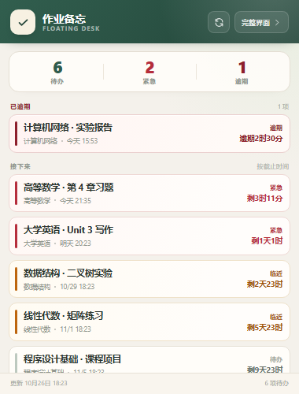

# 作业备忘 · 深大优课桌面版

版本：**1.1.0**

一个安装在 Windows 本机的桌面程序，自动登录
[深大优课（TronClass）](https://lms.szu.edu.cn/user/index)、同步未完成作业，并提供
**完整界面**和**置顶悬浮窗**两种模式。程序不会打开浏览器，主界面和悬浮窗都是应用自己的窗口。

> 非官方个人工具。数据来自 TronClass 的 `/api/todos`；学校系统升级后可能需要相应调整。




## 安装

双击运行：

```
release\作业备忘-安装程序-1.1.0.exe
```

安装程序会：

- 安装到 `%LOCALAPPDATA%\Programs\HomeworkDesk`，不需要管理员权限。
- 创建桌面、开始菜单快捷方式。
- 默认创建开机启动项；如果不想开机启动，可在安装时取消勾选「开机自动启动」。
- 不删除已有的登录数据，因此覆盖安装后会继续使用原来的登录状态。

## 使用

1. 双击桌面上的 **作业备忘**。
2. 首次打开会弹窗要求登录深大统一身份认证。学号/密码只在本机处理。
3. 登录后自动显示未完成作业。
4. 点击主界面右上角的 **悬浮窗**，会打开一个约 380 × 500 的置顶小窗；点击 **收起悬浮** 可关闭。
5. 在悬浮窗中点击 **完整界面**（或直接点悬浮窗右上角的 ×）会回到主窗口。
6. 点击主窗口右上角的 × 只是把窗口收起来，程序会继续在后台运行；
   任务栏通知区域会出现「作业备忘」托盘图标。

### 托盘图标

- 单击（或双击）托盘图标、或右键选择「打开主界面」，可以重新打开窗口。
- 右键菜单还可以「显示悬浮窗」或「退出作业备忘」。
- 窗口收起时再次双击桌面快捷方式，也会把已经运行的窗口叫回来，不会重复启动。
- 要彻底退出程序，请用托盘菜单里的「退出作业备忘」。

### 悬浮窗

- 窗口大小约 380 × 500，可调整，默认置顶。
- 显示待办数、紧急数、逾期数，以及按截止时间排序的作业列表。
- 支持刷新，与主界面的登录状态、作业数据实时同步。
- 完成作业仍在主界面勾选；悬浮窗用于常驻查看。

## 功能

- 只显示未完成作业，按截止时间升序排列。
- 逾期作业单独置顶，使用最醒目的「已逾期」样式。
- 48 小时内红色「紧急」、7 天内橙色「临近」、7 天以上正常显示。
- 顶部统计：未完成、紧急、临近、逾期。
- 最后更新时间、手动刷新、每 30 秒更新倒计时。
- 登录后自动保存会话；启动时优先复用会话，失效时使用本机加密保存的凭据自动登录。
- 勾选完成后从本应用移除，完成记录持久保存。

## 安全

- 桌面程序内嵌的本地服务只监听 `127.0.0.1` 的随机端口，不对局域网开放。
- 勾选「记住登录」后，学号和密码使用 **Windows DPAPI**（当前 Windows 用户范围）加密，
  保存在 `%LOCALAPPDATA%\HomeworkDesk\data\credentials.dat`。
- 登录 Cookie 同样使用 DPAPI 加密保存在本机。
- 密码只发送给 `authserver.szu.edu.cn`，作业数据只来自 `lms.szu.edu.cn`。
- 不勾选「记住登录」时不会保存密码，只保存本次会话。
- 在登录窗口点击「退出并清除登录信息」可删除本机凭据与会话。

## 已知限制

- 使用非官方接口，学校登录页或 TronClass 升级后可能失效。
- 如果学校登录页强制要求 **滑块验证码**，自动登录会暂停并提示稍后重试。
- 账号若启用短信验证码、FIDO/生物识别或校方二次确认，需要先按学校要求完成验证。
- 勾选完成只会从本应用隐藏，**不会替你在深大优课中提交作业**。
- 完成状态只保存在本机，不与其他设备同步。
- 首次登录前无法使用悬浮窗内容；悬浮窗会提示先登录。

## 文件位置

| 内容 | 路径 |
| --- | --- |
| 程序 | `%LOCALAPPDATA%\Programs\HomeworkDesk` |
| 登录数据 / 完成记录 | `%LOCALAPPDATA%\HomeworkDesk\data` |
| 日志 | `%LOCALAPPDATA%\HomeworkDesk\data\homework-desk.log` |

日志不含密码。

## 更新 / 卸载

- 更新：关闭应用后重新运行新版安装程序，数据会保留。
- 卸载：Windows「设置 → 应用 → 已安装的应用 → 作业备忘 → 卸载」。
  卸载程序会删除快捷方式和程序文件，但保留 `%LOCALAPPDATA%\HomeworkDesk\data`。
- 如需彻底清除登录数据和完成记录，卸载后手动删除
  `%LOCALAPPDATA%\HomeworkDesk\data`。

## 开发 / 重新打包

桌面壳使用 Python + pywebview（WebView2），界面仍是现有的单文件 HTML/CSS/JS。

```powershell
# 安装开发依赖
py -3.14 -m pip install -r requirements.txt

# 构建 EXE（输出到 dist\HomeworkDesk）
py -3.14 -m PyInstaller --noconfirm --clean HomeworkDesk.spec

# 构建安装程序（需要 Inno Setup 6，输出到 dist_installer）
& "$env:LOCALAPPDATA\Programs\Inno Setup 6\ISCC.exe" .\installer.iss
```

也可以运行 `build.ps1` 一次完成两步。

主要文件：

- `desktop_app.py`：桌面主程序、主窗口/悬浮窗和窗口切换。
- `homework_server.py`：内嵌本地服务、DPAPI 加密、深大登录与 TronClass 同步。
- `homework-reminder.html`：主界面。
- `floating.html`：悬浮窗界面。
- `HomeworkDesk.spec`：PyInstaller 打包配置。
- `installer.iss`：Inno Setup 安装脚本。
- `HANDOVER.md`：项目交接与维护说明。
- `CHANGELOG.md`：版本变更记录。

安全说明、构建流程和已知限制也见 [HANDOVER.md](HANDOVER.md)。
